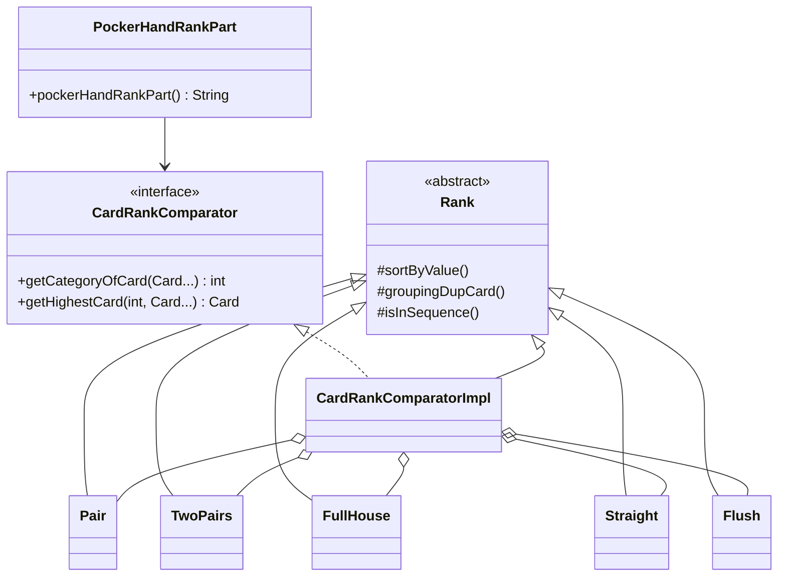

# Kata – Poker Hand Rank

[](https://github.com/ayouamani/kata-handRank/actions/workflows/ci.yml)


Implementation of the classic **Poker Hands** kata in plain Java, written test-first (TDD).
Two players, *Black* and *White*, each hold five cards. The program decides who wins and explains why:

```text
Black: 2H 3D 5S 9C KD   White: 2C 3H 4S 8C AH   →  "White wins. - with high card: Ace"
Black: 2H 4S 4C 2D 4H   White: 2S 8S AS QS 3S   →  "Black wins. - with full house: 4 over 2"
Black: 2H 3D 5S 9C KD   White: 2D 3H 5C 9S KH   →  "Tie."
```

## What this kata shows

- **TDD workflow** – every rule was introduced by a failing test first (`PockerHandRankPartTest`), then the simplest code to make it pass, then refactoring.
- **One class per rule** – each hand category (`Pair`, `TwoPairs`, `ThreeOfKind`, `Straight`, `Flush`, `FullHouse`, `FourOfKind`, `StraightFlush`, `HighCard`) lives in its own small class, so a rule can be read, tested and changed in isolation (Single Responsibility / Open-Closed).
- **Dependency injection without a framework** – the rules are injected into `CardRankComparatorImpl` through its constructor and the game depends on the `CardRankComparator` interface, which keeps the scoring logic easy to test and to swap.
- **Functional Java** – grouping, counting and sorting of cards are done with the Stream API (`Collectors.groupingBy`, `counting`, comparators) in the shared `Rank` base class.
- **Immutable value objects** – `Card`, `Value`, `Suit` and enums for categories and players.

## Design



1. Each hand is mapped to a `CategoryCardRank` (high card → straight flush), the strongest category wins.
2. On equal categories, the tie-breaker depends on the category (value of the pair, highest pair of two pairs, the three cards of a full house, highest card…).
3. The result is formatted by `FinalMsg`.

## Tech stack

| | |
|---|---|
| Language | Java 8+ (no framework) |
| Build | Maven |
| Tests | JUnit 5 (Jupiter) |
| CI | GitHub Actions |

## Run it

Requirements: JDK 8 or later and Maven 3.6+.

```bash
git clone https://github.com/ayouamani/kata-handRank.git
cd kata-handRank/handRank
mvn test
```

## Project structure

```text
handRank/
├── src/main/java
│   ├── handRank/     # game orchestration, comparator, shared Rank helpers
│   ├── functions/    # one class per poker rule
│   └── models/       # Card, Value, Suit, Player, categories, result message
└── src/test/java
    └── handRank/PockerHandRankPartTest.java
```

## Possible next steps

- Parse hands from strings (`"2H 3D 5S 9C KD"`) and add a small CLI.
- Replace the `if` chain in `getCategoryOfCard` with an ordered list of rule objects.
- Parameterized tests (`@ParameterizedTest`) to cover every category and tie-breaker.
